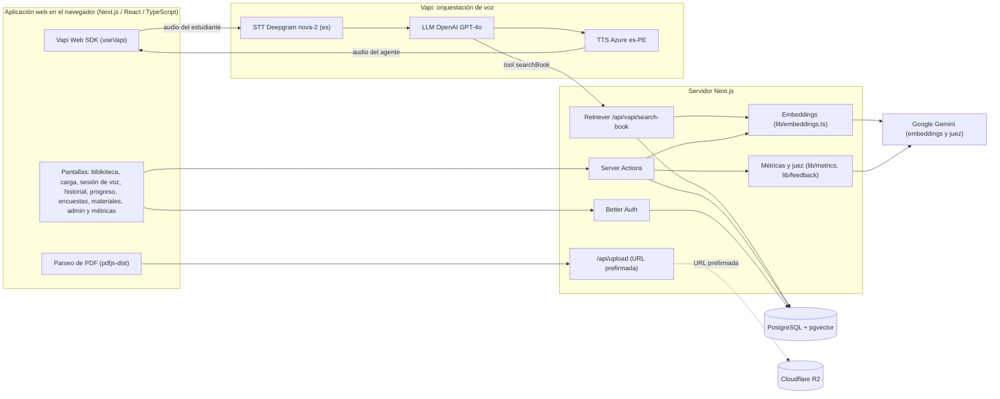
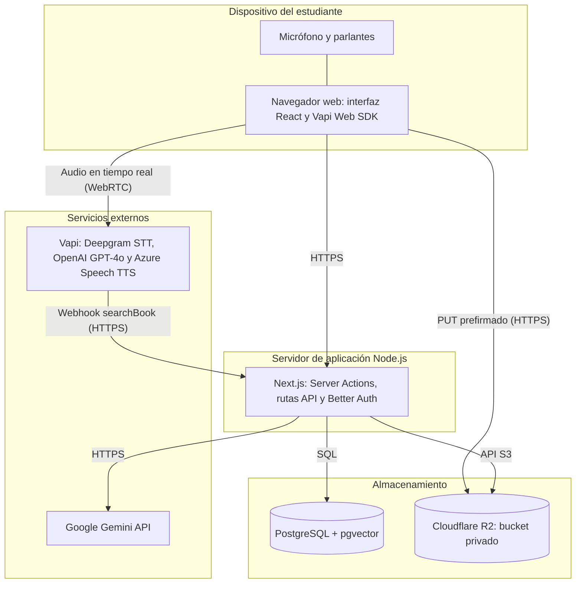
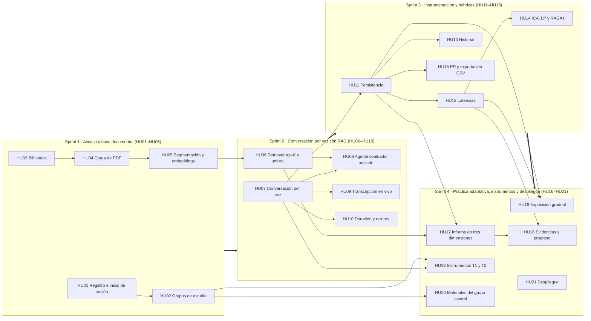

**UNIVERSIDAD NACIONAL DE TRUJILLO  
FACULTAD DE INGENIERÍA  
ESCUELA ACADÉMICO PROFESIONAL DE INGENIERÍA DE SISTEMAS**

**  
INVESTFIED: DOCUMENTACIÓN FUNCIONAL DEL SOFTWARE**

**  
AUTOR:  
**Jondec Delgado, Cristhian André  
**  
DOCENTE:  
**Mendoza Rivera, Ricardo Darío  
 TRUJILLO - PERÚ  
30/09/2026

# Propósito del documento

Este documento describe las funcionalidades de INVESTFIED a partir de las historias de usuario organizadas por sprint. Cada historia incluye descripción, un espacio para la evidencia visual y el flujo de ejecución. Antes de las historias se presentan la arquitectura de componentes, el despliegue y la dependencia funcional entre sprints.

# Resumen por sprint

| **Sprint** | **Enfoque** | **Historias** |
| --- | --- | --- |
| Sprint 1 | Acceso y base documental | HU01, HU02, HU03, HU04, HU05 |
| Sprint 2 | Conversación por voz con RAG | HU06, HU07, HU08, HU09, HU10 |
| Sprint 3 | Instrumentación y métricas | HU11, HU12, HU13, HU14, HU15 |
| Sprint 4 | Práctica adaptativa, instrumentos y despliegue | HU16, HU17, HU18, HU19, HU20, HU21 |

# Arquitectura y dependencias

## Diagrama de componentes

El diagrama de componentes muestra las relaciones lógicas entre la aplicación web, la orquestación de voz, la recuperación aumentada y el almacenamiento. La aplicación Next.js es el único punto que accede a la base de datos. Vapi coordina el ciclo de voz y, cuando el LLM necesita contexto, invoca el tool searchBook, que llega al retriever de la aplicación. El retriever embebe la consulta con Gemini y busca los fragmentos más cercanos en PostgreSQL con pgvector. Los archivos PDF y las portadas se guardan en Cloudflare R2.

*Figura 1. Diagrama de componentes de INVESTFIED*

**[ESPACIO RESERVADO PARA IMAGEN]**

*Tipo de figura: diagrama de componentes UML. Debe incluir la aplicación web Next.js/React/TypeScript (pantallas, parseo de PDF y Vapi Web SDK), el servidor Next.js (Server Actions, Better Auth, /api/upload, retriever /api/vapi/search-book, módulo de embeddings y módulo de métricas y juez), Vapi con sus tres subcomponentes (STT Deepgram, LLM GPT-4o y TTS Azure es-PE), Google Gemini (embeddings y juez), PostgreSQL con pgvector y Cloudflare R2. Las flechas deben mostrar el ciclo STT → LLM → TTS, la llamada del LLM al tool searchBook y el camino retriever → embeddings → pgvector.*

Código Mermaid sugerido para generar la figura (borrarlo después de insertar la imagen):

## Diagrama de despliegue

El diagrama de despliegue muestra dónde se ejecutan los componentes y cómo se conectan durante una sesión. El repositorio no documenta un proveedor de alojamiento para la aplicación, así que el nodo del servidor se rotula de forma genérica como servidor de aplicación Node.js.

*Figura 2. Diagrama de despliegue de INVESTFIED*

**[ESPACIO RESERVADO PARA IMAGEN]**

*Tipo de figura: diagrama de despliegue UML con nodos y conexiones rotuladas. Nodos: (1) dispositivo del estudiante con navegador web, micrófono y parlantes, que ejecuta la interfaz React y el Vapi Web SDK; (2) servidor de aplicación Node.js con Next.js (Server Actions, rutas API y Better Auth); (3) servidor PostgreSQL con la extensión pgvector; (4) Cloudflare R2 con un bucket privado; (5) plataforma Vapi con Deepgram, OpenAI y Azure Speech; (6) API de Google Gemini. Conexiones: navegador ↔ servidor por HTTPS; navegador ↔ Vapi con audio en tiempo real por WebRTC; navegador → R2 con PUT prefirmado por HTTPS; Vapi → servidor con el webhook HTTPS del tool searchBook; servidor → PostgreSQL por SQL; servidor → R2 por la API compatible con S3; servidor → Gemini por HTTPS. No rotular un proveedor de alojamiento que no se haya usado.*

Código Mermaid sugerido para generar la figura (borrarlo después de insertar la imagen):

## Diagrama de dependencia de sprints

La figura siguiente muestra la dependencia funcional entre la base documental, la conversación, la instrumentación y las extensiones de práctica. Cada sprint necesita el incremento del anterior. Las ventanas de fechas son las planificadas y no se presentan como fechas verificadas.

*Figura 3. Dependencia funcional de los cuatro sprints*

**[ESPACIO RESERVADO PARA IMAGEN]**

*Tipo de figura: diagrama de flujo horizontal con cuatro bloques en secuencia: Sprint 1 (HU01–HU05) → Sprint 2 (HU06–HU10) → Sprint 3 (HU11–HU15) → Sprint 4 (HU16–HU21). Dentro de cada bloque se muestran sus historias, y entre bloques se trazan las dependencias entre historias: HU04 → HU05 → HU06 → HU08 (sin documento vectorizado no hay recuperación ni preguntas ancladas); HU07 → HU09 y HU07 → HU11 (sin conversación no hay transcripción ni turnos que guardar); HU11 → HU12 → HU14 y HU11 → HU15 (las métricas se calculan sobre sesiones persistidas); HU11 y HU12 → HU16 (la regla de adaptación lee la sesión anterior); HU06 y HU11 → HU17 (el informe cita fragmentos recuperados de turnos guardados); HU12 y HU17 → HU18 (las evidencias comparan latencias y dimensiones entre sesiones); HU02 → HU19 y HU02 → HU20 (los instrumentos y los materiales dependen del grupo asignado); HU07 → HU19 (la SUS se desbloquea tras una conversación). HU21 depende del conjunto de incrementos.*

Código Mermaid sugerido para generar la figura (borrarlo después de insertar la imagen):

# Documentación funcional por historia de usuario

## Sprint 1: Acceso y base documental

Este sprint establece el acceso seguro, la separación de los participantes en grupo experimental y grupo control, la biblioteca de investigaciones y el procesamiento del PDF hasta dejarlo segmentado y vectorizado en la base de datos.

| **HU01: Registro e inicio de sesión** |
| --- |
| **Descripción:** Permite que el estudiante cree una cuenta e ingrese al sistema con su correo y contraseña. |
| **[ESPACIO RESERVADO PARA IMAGEN]** Captura sugerida: pantallas /sign-in y /sign-up con sus formularios de correo y contraseña. |
| **Descripción del flujo de ejecución:**  1\. El usuario ingresa a la pantalla de inicio de sesión.  2\. Si ya tiene cuenta, escribe su correo y contraseña y presiona Iniciar sesión.  3\. Si no tiene cuenta, entra a Registrarse, completa nombre, correo y contraseña y envía el formulario.  4\. Better Auth valida las credenciales, crea la sesión y la guarda en PostgreSQL.  5\. Si el usuario intenta abrir una ruta protegida sin sesión, el middleware lo redirige a /sign-in.  6\. Con la sesión activa, el sistema lo envía a la pantalla que corresponde a su grupo de estudio. |

| **HU02: Grupos de estudio y control de acceso** |
| --- |
| **Descripción:** Permite al investigador asignar a cada participante al grupo experimental o al grupo control y darle un código de participante. El acceso a cada pantalla depende de ese grupo. |
| **[ESPACIO RESERVADO PARA IMAGEN]** Captura sugerida: panel /admin con el selector de grupo y el código de participante, y la pantalla /sin-asignar. |
| **Descripción del flujo de ejecución:**  1\. Un usuario recién registrado no tiene grupo y el sistema lo mantiene en /sin-asignar con el mensaje Tu cuenta está en revisión.  2\. El investigador ingresa a /admin, cuyo acceso se valida con el correo definido en ADMIN_EMAIL.  3\. Busca al participante en el detalle por usuario.  4\. Le asigna el grupo experimental o el grupo control y, si corresponde, un código de participante único.  5\. El sistema guarda el grupo en la base de datos y lo lee de allí en cada pantalla y en cada Server Action.  6\. Si el participante es experimental, accede a la biblioteca, las sesiones de voz, el historial, el progreso y las encuestas.  7\. Si es control, solo accede a /materiales y /surveys, y cualquier otra ruta lo redirige a /materiales.  8\. Si el investigador quita el grupo, la cuenta vuelve a quedar bloqueada en /sin-asignar. |

| **HU03: Biblioteca de investigaciones** |
| --- |
| **Descripción:** Permite al estudiante del grupo experimental ver, buscar y eliminar sus investigaciones cargadas y abrir la sesión de práctica de cada una. |
| **[ESPACIO RESERVADO PARA IMAGEN]** Captura sugerida: página de inicio con la sección Investigaciones Recientes, el buscador y las tarjetas con portada. |
| **Descripción del flujo de ejecución:**  1\. El estudiante ingresa a la página de inicio.  2\. El sistema lista solo las investigaciones del usuario autenticado, de la más reciente a la más antigua.  3\. Si escribe en el buscador, la lista se filtra por título o autor.  4\. Cada tarjeta muestra la portada, que se entrega desde R2 mediante /api/cover/[bookId].  5\. Si el estudiante elimina una investigación, el sistema verifica que le pertenezca, la borra y muestra la confirmación.  6\. Al seleccionar una tarjeta, el estudiante entra a la sesión de práctica de esa investigación. |

| **HU04: Carga de investigación en PDF** |
| --- |
| **Descripción:** Permite subir el avance de investigación en PDF, con portada opcional, título y voz del docente evaluador, para convertirlo en la fuente de la sustentación. |
| **[ESPACIO RESERVADO PARA IMAGEN]** Captura sugerida: pantalla /books/new con el formulario completo y el selector de voz Camila o Alex. |
| **Descripción del flujo de ejecución:**  1\. El estudiante ingresa a Agregar.  2\. Si ya tiene cuatro investigaciones, el sistema muestra el aviso de límite alcanzado y no permite subir otra.  3\. Adjunta el archivo PDF, de hasta 50 MB.  4\. Opcionalmente adjunta una portada JPG, PNG o WEBP, de hasta 10 MB.  5\. Escribe el título y elige la voz del docente evaluador: Camila (femenina) o Alex (masculina), ambas en español peruano.  6\. El sistema valida que no exista otra investigación con el mismo título.  7\. El navegador pide a /api/upload una URL prefirmada y sube el PDF y la portada directamente al bucket privado de R2.  8\. Si no se adjuntó portada, el sistema usa la imagen de la primera página del PDF.  9\. El sistema registra la investigación con la voz elegida y continúa con el procesamiento del texto. |

| **HU05: Extracción, segmentación y embeddings** |
| --- |
| **Descripción:** Extrae el texto del PDF conservando la página de origen, lo divide en segmentos y genera sus embeddings para guardarlos en la base de datos vectorial. |
| **[ESPACIO RESERVADO PARA IMAGEN]** Captura sugerida: registros de la tabla book_segments en Drizzle Studio, con contenido, número de página y embedding. |
| **Descripción del flujo de ejecución:**  1\. El sistema lee el PDF con pdfjs-dist y extrae el texto de cada página.  2\. Divide el texto en segmentos de 500 palabras con un solape de 50 palabras y registra la página de origen de cada segmento.  3\. Envía los segmentos por lotes al modelo gemini-embedding-001, que devuelve vectores de 768 dimensiones.  4\. Guarda cada segmento con su texto, página y embedding en la tabla book_segments.  5\. El índice HNSW con distancia coseno deja los segmentos listos para la búsqueda semántica.  6\. Si falla el guardado de los segmentos, el sistema muestra el mensaje Error al guardar los segmentos de la investigación.  7\. Si todo termina bien, el estudiante pasa directamente a la sesión de práctica de esa investigación. |

## Sprint 2: Conversación por voz con RAG

Este sprint integra los cinco componentes de la arquitectura en un ciclo síncrono: el estudiante habla, Vapi transcribe, el LLM recupera fragmentos del documento mediante el retriever, formula una pregunta anclada en ese contexto y la voz sintetizada la reproduce.

| **HU06: Recuperación de contexto con top-K y umbral** |
| --- |
| **Descripción:** Recupera los fragmentos más cercanos a la consulta del agente, descarta los que no superan el umbral de relevancia y los devuelve con su número de página. |
| **[ESPACIO RESERVADO PARA IMAGEN]** Captura sugerida: sección Recuperaciones del documento en el detalle de una sesión, con la consulta, los fragmentos y sus distancias. |
| **Descripción del flujo de ejecución:**  1\. Durante la conversación, el LLM decide que necesita contexto e invoca el tool searchBook con bookId, sessionId y la consulta.  2\. Vapi envía la solicitud al webhook /api/vapi/search-book.  3\. El sistema valida los parámetros y embebe la consulta con Gemini.  4\. Busca en book_segments los cinco fragmentos más cercanos por distancia coseno (top-K = 5).  5\. Descarta los fragmentos con una distancia mayor a 0,6.  6\. Si quedan fragmentos, los devuelve al LLM precedidos por su página.  7\. Si no queda ninguno, devuelve un mensaje que obliga al agente a decir que el tema no aparece en la investigación.  8\. Después de responder a Vapi, el sistema registra la recuperación asociada a la sesión. |

| **HU07: Conversación por voz síncrona** |
| --- |
| **Descripción:** Permite al estudiante sostener una conversación por voz en tiempo real con el agente, con reconocimiento y síntesis de voz en español. |
| **[ESPACIO RESERVADO PARA IMAGEN]** Captura sugerida: pantalla de sesión de voz con el indicador de estado, el temporizador y el nivel activo. |
| **Descripción del flujo de ejecución:**  1\. El estudiante abre una investigación de su biblioteca.  2\. Completa el panel Antes de empezar y presiona Iniciar.  3\. El sistema crea el registro de la sesión y llama a Vapi con el ASSISTANT_ID y los assistantOverrides: prompt, modelo, primer mensaje del nivel, voz elegida y variables de la sesión.  4\. Vapi transcribe la voz del estudiante con Deepgram nova-2 en español.  5\. El LLM GPT-4o genera la réplica del docente evaluador.  6\. Azure Speech la sintetiza con la voz es-PE-CamilaNeural o es-PE-AlexNeural.  7\. El indicador de estado muestra si el agente está hablando o escuchando, y el ciclo se repite en cada turno.  8\. Si el estudiante presiona Finalizar conversación, la llamada se corta de inmediato. |

| **HU08: Agente docente evaluador anclado** |
| --- |
| **Descripción:** Define el comportamiento del agente como docente evaluador de una sustentación de avance: pregunta en español, una cosa a la vez, basándose solo en el documento del estudiante. |
| **[ESPACIO RESERVADO PARA IMAGEN]** Captura sugerida: transcripción de una sesión en la que el agente menciona la página del documento en su pregunta. |
| **Descripción del flujo de ejecución:**  1\. En cada llamada, el sistema envía a Vapi el system prompt de lib/agent-prompt.ts y el modelo EVALUATOR_MODEL (GPT-4o, temperatura 0,4).  2\. El agente abre la sesión con el primer mensaje del nivel de exigencia elegido.  3\. Antes de preguntar sobre el contenido, consulta el documento con searchBook.  4\. Formula una sola pregunta por turno, breve y sin listas, y puede citar la página del fragmento recuperado.  5\. Avanza en orden por las fases de la sustentación: apertura, problema y justificación, metodología, y resultados y conclusiones. Cuando una respuesta es vaga o contradice el documento, repregunta como máximo dos veces, y termina con un cierre de fortalezas y puntos a corregir.  6\. Si el tema no aparece en el documento, lo dice explícitamente y no inventa contenido.  7\. Ante un silencio, espera. Si el estudiante lo pide, reformula la pregunta.  8\. Responde siempre en español y no actúa como asistente de redacción. |

| **HU09: Transcripción en tiempo real** |
| --- |
| **Descripción:** Muestra durante la sesión la transcripción de lo que dicen el estudiante y el agente. |
| **[ESPACIO RESERVADO PARA IMAGEN]** Captura sugerida: panel de transcripción con turnos del estudiante y del agente durante una sesión activa. |
| **Descripción del flujo de ejecución:**  1\. Al iniciar la sesión, el panel de transcripción queda visible debajo de los controles.  2\. Mientras el estudiante habla, el sistema muestra su texto parcial y lo reemplaza por el texto final.  3\. El texto del agente se toma de los mensajes voice-input de Vapi, que contienen el texto literal enviado a la síntesis de voz.  4\. El turno del agente se cierra cuando el estudiante empieza a hablar o cuando termina la llamada.  5\. Cada turno cerrado se agrega al historial visible de la conversación. |

| **HU10: Duración máxima y manejo de errores** |
| --- |
| **Descripción:** Limita la sesión a 20 minutos, avisa al agente para que cierre a tiempo e informa al estudiante con mensajes claros cuando falla la conexión, el micrófono o un servicio externo. |
| **[ESPACIO RESERVADO PARA IMAGEN]** Captura sugerida: temporizador de la sesión y panel de requisitos abierto con el mensaje sobre conexión, micrófono y parlantes. |
| **Descripción del flujo de ejecución:**  1\. Antes de iniciar, el estudiante puede abrir el panel de requisitos, que indica que necesita conexión estable, micrófono y parlantes o audífonos.  2\. Durante la sesión, el temporizador muestra el tiempo transcurrido sobre el máximo de 20 minutos.  3\. Tres minutos antes del límite, el sistema indica al agente que empiece el cierre.  4\. Vapi corta la llamada al alcanzar la duración máxima.  5\. Si la sesión termina por inactividad, por pérdida de conexión o de forma inesperada, el sistema muestra el mensaje correspondiente e invita a reintentar.  6\. Si no se pudo iniciar, indica revisar la conexión, el permiso del micrófono y la disponibilidad de los servicios externos. |

## Sprint 3: Instrumentación y métricas

Este sprint convierte cada sesión en evidencia medible: guarda turnos, recuperaciones y latencias, permite revisar el historial y calcula las métricas que exige la investigación.

| **HU11: Persistencia de sesiones, turnos y recuperaciones** |
| --- |
| **Descripción:** Guarda cada sesión de voz con sus turnos y los fragmentos recuperados para analizar después la conversación. |
| **[ESPACIO RESERVADO PARA IMAGEN]** Captura sugerida: tablas voice_sessions, session_turns y turn_retrievals en Drizzle Studio con datos de una sesión. |
| **Descripción del flujo de ejecución:**  1\. Al iniciar, el sistema verifica que la investigación pertenezca al estudiante y crea el registro en voice_sessions con el nivel, su origen y la autoevaluación previa.  2\. Cuando Vapi confirma la llamada, el sistema asocia su identificador a la sesión.  3\. Cada turno cerrado del estudiante o del agente se guarda en session_turns con su rol, texto y orden.  4\. Si un turno recibe más texto después de guardarse, el sistema lo actualiza.  5\. Cada recuperación del retriever se guarda en turn_retrievals con la consulta, el segmento y la distancia.  6\. Al terminar la llamada, el sistema registra el fin y la duración de la sesión. |

| **HU12: Registro de latencias** |
| --- |
| **Descripción:** Registra la latencia del sistema y la latencia de respuesta verbal del estudiante en cada turno. |
| **[ESPACIO RESERVADO PARA IMAGEN]** Captura sugerida: sección Rendimiento de la sesión con la respuesta del estudiante, la respuesta del sistema y la latencia por turno. |
| **Descripción del flujo de ejecución:**  1\. El sistema escucha los eventos de inicio y fin de habla de Vapi.  2\. Cuando el estudiante termina de hablar, empieza a medir la latencia del sistema, que termina cuando el agente comienza su réplica.  3\. Cuando el agente termina su pregunta, empieza a medir la latencia del estudiante, que termina con su primera palabra.  4\. Cada latencia se guarda en el turno correspondiente, como systemLatencyMs o studentLatencyMs.  5\. Si no hay medición, el valor queda vacío y se muestra como Sin datos, nunca como cero.  6\. Las dos latencias se reportan por separado y nunca se promedian juntas. |

| **HU13: Historial y detalle de sesiones** |
| --- |
| **Descripción:** Permite al estudiante revisar sus sesiones anteriores y el detalle completo de cada una, en modo de solo lectura. |
| **[ESPACIO RESERVADO PARA IMAGEN]** Captura sugerida: pantalla /history con la lista de sesiones y la pantalla de detalle con su menú de secciones. |
| **Descripción del flujo de ejecución:**  1\. El estudiante abre Historial desde el menú de su perfil o desde una investigación.  2\. El sistema lista sus sesiones con fecha, duración, número de mensajes, nivel y autoevaluaciones.  3\. Al elegir una sesión, el sistema verifica que le pertenezca y carga el detalle.  4\. El detalle muestra la conversación, el informe, las evidencias de avance, la exposición gradual, el rendimiento, las recuperaciones y la evaluación de respuestas.  5\. La conversación no puede continuarse desde el historial. |

| **HU14: Panel de ICA, LP y RAGAs** |
| --- |
| **Descripción:** Calcula y muestra al investigador el ICA, la latencia promedio del sistema, la latencia del estudiante y las métricas RAGAs a partir de los datos registrados. |
| **[ESPACIO RESERVADO PARA IMAGEN]** Captura sugerida: pantalla /metrics con las tarjetas de ICA, LP, latencia del estudiante y RAGAs. |
| **Descripción del flujo de ejecución:**  1\. El investigador ingresa a /metrics, cuyo acceso se valida con METRICS_OWNER_EMAILS.  2\. El sistema calcula el ICA como (Ci / Ct) × 100 a partir del registro de los cinco componentes: STT, LLM, base vectorial, retriever y TTS.  3\. Calcula la LP como el promedio de las latencias del sistema, con mediana, mínimo y máximo.  4\. Muestra aparte la latencia de respuesta verbal del estudiante con los mismos estadísticos.  5\. Si hay ternas pendientes, el investigador presiona calcular RAGAs y el juez gemini-2.5-flash evalúa fidelidad, pertinencia, precisión del contexto y cobertura del contexto.  6\. El panel muestra también los promedios de la retroalimentación en tres dimensiones y el resumen de la exposición gradual.  7\. Si cambia la versión del prompt del juez, el investigador puede borrar los puntajes y volver a calcularlos. |

| **HU15: Revisión humana (PR) y exportación CSV** |
| --- |
| **Descripción:** Permite revisar a mano cada respuesta del agente para calcular la precisión de respuestas (PR) y exportar las métricas en CSV para el análisis estadístico. |
| **[ESPACIO RESERVADO PARA IMAGEN]** Captura sugerida: pantalla /metrics/revision con una respuesta del agente, la pregunta previa, los fragmentos y los botones de evaluación. |
| **Descripción del flujo de ejecución:**  1\. El investigador ingresa a Revisión de respuestas desde /metrics.  2\. Filtra los turnos pendientes, revisados o todos.  3\. En cada turno revisa la intervención previa del estudiante, la respuesta del agente y los fragmentos recuperados.  4\. Marca la respuesta como correcta o incorrecta según el criterio de revisión, o quita una evaluación ya hecha.  5\. El sistema calcula PR como (Rc / Rt) × 100, donde Rt son solo los turnos revisados, y reporta los pendientes aparte.  6\. Desde /metrics, el investigador exporta tres CSV (turnos, sesiones y participantes) en UTF-8 y con el código de participante.  7\. Los archivos quedan listos para cruzarlos con las encuestas en SPSS o R. |

## Sprint 4: Práctica adaptativa, instrumentos y despliegue

Este sprint agrega las extensiones que diferencian al producto de un asistente genérico de consulta de documentos: exigencia adaptativa, retroalimentación en tres dimensiones y evidencias de avance. También incorpora los instrumentos del estudio para ambos grupos y deja el sistema desplegado para la intervención.

| **HU16: Exposición gradual adaptativa** |
| --- |
| **Descripción:** Ofrece cuatro niveles de exigencia y sugiere uno con una regla determinista a partir de la autoevaluación del estudiante y de su sesión anterior. El estudiante puede cambiarlo. |
| **[ESPACIO RESERVADO PARA IMAGEN]** Captura sugerida: panel Antes de empezar con la escala de 0 a 10, el nivel sugerido y las cuatro tarjetas de nivel. |
| **Descripción del flujo de ejecución:**  1\. Al abrir una investigación, el sistema muestra el panel Antes de empezar.  2\. El estudiante responde de 0 a 10 qué tan nervioso se siente por sustentar. La respuesta es opcional.  3\. La regla de adaptación parte de esa respuesta y la respalda con el nivel y los indicadores de la sesión anterior (silencios largos, respuestas incompletas, pedidos de reformulación y latencia media del estudiante). Con eso sugiere subir, mantener o bajar un nivel.  4\. El sistema muestra el nivel sugerido con su motivo: Ensayo seguro, Práctica guiada, Simulación realista o Simulación desafiante.  5\. Si el estudiante elige otro nivel, el sistema registra que la elección fue manual.  6\. Al iniciar, el nivel determina el primer mensaje y las directivas que recibe el agente. |

| **HU17: Informe post-sesión en tres dimensiones** |
| --- |
| **Descripción:** Entrega al estudiante un informe que separa dominio del contenido, claridad y estructura, y conducta comunicativa registrada, sin una nota global. Todo juicio de contenido cita el fragmento del documento que lo respalda. |
| **[ESPACIO RESERVADO PARA IMAGEN]** Captura sugerida: sección Informe de la sesión con las tres tarjetas de dimensión y el detalle por pregunta con su cita. |
| **Descripción del flujo de ejecución:**  1\. Al cerrar la sesión, el estudiante llega al informe en /history/[sessionId]#informe.  2\. El sistema muestra cuántas respuestas están evaluadas, pendientes o sin fragmento recuperado.  3\. El estudiante presiona Evaluar pendientes.  4\. El juez evalúa el contenido de cada respuesta con la rúbrica y debe citar uno de los fragmentos recuperados para esa pregunta.  5\. Si no hay una cita válida, el juicio de contenido queda como no concluyente, nunca como cero.  6\. La claridad se evalúa a partir de la pregunta y la respuesta, sin cita.  7\. La conducta comunicativa se reporta como hechos registrados: silencios largos, respuestas incompletas, pedidos de reformulación y latencias.  8\. El informe muestra las tres dimensiones por separado y el detalle por pregunta. |

| **HU18: Evidencias de avance y progreso** |
| --- |
| **Descripción:** Muestra al cerrar la sesión los avances respaldados por un dato, registra la autoevaluación final y permite consultar la evolución del estudiante entre sesiones. |
| **[ESPACIO RESERVADO PARA IMAGEN]** Captura sugerida: modal de cierre con el Resumen de la sesión y la escala final, y la pantalla /progreso con sus gráficos. |
| **Descripción del flujo de ejecución:**  1\. Al finalizar la conversación, el sistema abre el modal de cierre.  2\. El modal muestra por escrito las evidencias de la sesión: logros registrados y mejoras respecto de la sesión anterior con el mismo documento, cada una con su dato.  3\. Si algo empeoró, también se muestra con su dato.  4\. El estudiante responde la autoevaluación final de 0 a 10 y la guarda.  5\. El sistema lo lleva directamente al informe de la sesión.  6\. En Mi progreso, el estudiante elige una investigación y ve la evolución de la latencia de respuesta, el dominio del contenido, la claridad, los temas respondidos con respaldo y las autoevaluaciones previa y posterior.  7\. Con una sola sesión medida, el sistema indica que todavía no hay evolución que leer. |

| **HU19: Instrumentos de medición basal y posterior** |
| --- |
| **Descripción:** Permite a los participantes responder los instrumentos del estudio en T1 y T2, y al investigador seguir su avance y exportar los puntajes para comparar ambas mediciones. |
| **[ESPACIO RESERVADO PARA IMAGEN]** Captura sugerida: pantalla /surveys con las cinco etapas y sus estados, y el resumen de encuestas en /admin. |
| **Descripción del flujo de ejecución:**  1\. El participante ingresa a Encuestas.  2\. Las dos mediciones basales, STAI T1 (20 ítems, escala de 0 a 3) y PRCS-12 T1 (12 ítems, escala de 1 a 6), están disponibles en cualquier orden.  3\. En el grupo experimental, la SUS (10 ítems, escala de 1 a 5) se desbloquea cuando completa ambas basales y al menos una conversación con el agente.  4\. STAI T2 se desbloquea después de la SUS en el grupo experimental, o después de las basales en el grupo control.  5\. PRCS-12 T2 se desbloquea después de STAI T2.  6\. Al enviar, el sistema valida que todas las respuestas estén completas, calcula el puntaje con la regla de cada instrumento, incluidos los ítems invertidos, y lo guarda.  7\. En /admin, el investigador ve el estado de cada etapa por participante y exporta el resumen de encuestas en CSV. |

| **HU20: Materiales del grupo control** |
| --- |
| **Descripción:** Permite al investigador compartir PDF de preparación con el grupo control, que recibe una condición pasiva sin el agente de voz. |
| **[ESPACIO RESERVADO PARA IMAGEN]** Captura sugerida: sección Materiales compartidos en /admin y la pantalla /materiales vista por un participante control. |
| **Descripción del flujo de ejecución:**  1\. El investigador ingresa a /admin, a la sección Materiales compartidos.  2\. Escribe un título, una descripción opcional y adjunta un PDF.  3\. El sistema valida el archivo, lo sube a R2 y registra el material.  4\. El participante control ingresa a /materiales.  5\. Ve los documentos compartidos, los doce temas típicos de una sustentación y las recomendaciones de preparación.  6\. Al abrir un documento, el sistema verifica que el usuario tenga acceso a materiales y lo entrega desde R2.  7\. Un participante experimental que intenta abrir /materiales es redirigido a la biblioteca. |

| **HU21: Despliegue y operación del sistema** |
| --- |
| **Descripción:** Permite publicar y operar la aplicación con una configuración reproducible de la base de datos, el almacenamiento y los servicios externos.  **Pantallas o componentes:** .env, drizzle.config.ts, carpeta drizzle/, package.json, configuración del assistant en Vapi y docs/agente/. |
| **[ESPACIO RESERVADO PARA IMAGEN]** Captura sugerida: configuración del tool searchBook en el dashboard de Vapi con su server URL, y la aplicación en ejecución. |
| **Descripción del flujo de ejecución:**  1\. El equipo configura las variables de entorno de base de datos, Better Auth, Cloudflare R2, Vapi, Gemini y los correos de administrador y de métricas.  2\. Prepara PostgreSQL con la extensión pgvector y aplica las migraciones con npm run db:migrate.  3\. Crea el bucket privado de R2 para los PDF, las portadas y los materiales.  4\. En el dashboard de Vapi configura el assistant, el transcriber y el tool searchBook con la URL pública de /api/vapi/search-book.  5\. Compila la aplicación con npm run build y la ejecuta con npm run start.  6\. El system prompt, el modelo, la voz y el plan de turnos se envían desde el código en cada llamada, así que no dependen de la configuración del dashboard.  7\. El investigador asigna los grupos de estudio y el sistema queda listo para la intervención. |
